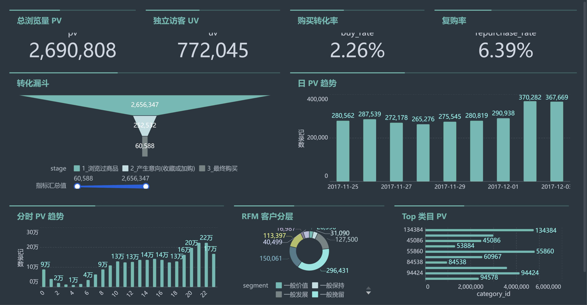

# 淘宝用户行为数据分析报告

## 一、分析背景与目标

本分析基于阿里天池公开的"淘宝用户行为数据"（2017-11-25 至 2017-12-03，双十一后两周）。目标是用 SQL 独立完成一次端到端的电商用户行为分析：摸清平台流量规模与结构，定位用户从浏览到购买的核心流失环节，找出访问与转化的时段规律，对客户做价值分层，并检验类目流量的集中程度。最终结论落到可执行的运营动作上。

## 二、数据说明

数据为淘宝 2017 年 11 月 25 日至 12 月 3 日真实脱敏的用户行为日志，官网标注原始规模约 1 亿条、98.8 万用户。本机环境全量入库查询过慢，故按 3% 固定种子分块随机抽样，得到 **300.4 万条记录、80.2 万用户、94.8 万商品、7,414 个类目**。字段包括 user_id、item_id、category_id、behavior_type（pv 浏览 / fav 收藏 / cart 加购 / buy 购买四种行为）、timestamp 时间戳。

清洗处理：原始数据混有约 0.007% 的脏时间戳（日期可跑到 1920 年和 2030 年），按分析窗口 2017-11-25~12-03 过滤后保留 300.4 万行；样本的日 PV/UV 与行为占比经与原始分布校验一致；category_id=0 视为缺失类目单独处理，不参与类目分析。

## 三、分析方法

共五个分析模块，全部基于 MySQL 8.0 窗口函数实现：

1. **流量分析**：整体规模、行为分布、日 PV/UV 趋势、分时访问规律、用户活跃度分布；
2. **转化漏斗**：跑三层口径——行为量口径、用户覆盖口径、用户-商品路径口径（严格漏斗），并计算加购到支付的时间间隔；
3. **RFM 分层**：数据集无金额字段，M 用行为加权分（pv=1 / fav=3 / cart=4 / buy=5）作代理，R、F、M 各取五分位（R 按距今天数反向排序打分），按规则分八类后再合并为三类；
4. **复购分析**：计算买家复购率（购买≥2 次用户 ÷ 购买用户），并用 LAG 窗口函数取相邻两次购买日期求平均复购周期；
5. **类目分析**：类目流量 TopN、高流量低转化类目识别、累计占比二八集中度检验。

## 四、分析结论

**结论 1（规模与结构）：高频浏览、低频下单。** 样本覆盖 80.2 万用户、94.8 万商品、7,414 个类目的 300.4 万条行为记录。行为结构中浏览占 **89.57%**，购买仅占 **2.02%**，用户整体处于"逛而不买"状态；78.91% 的用户全周期仅发生 1-5 次行为，平台以浅层访客为主，深度用户占比低。

**结论 2（漏斗与流失）："加购→购买"是流失最严重的环节。** 商品级路径口径下，浏览过某商品的用户-商品对中仅 0.209% 产生加购，加购后最终购买的仅 **0.211%**（16.6 万加购对中仅 351 对成交），加购未购占 99.79%；而用户覆盖口径下加购→购买转化率为 **41.6%**（13.6 万加购用户中 5.67 万购买）。两种口径差异极大，说明漏斗分析必须显式定义口径。加购到支付平均间隔 **34 小时**，用户从产生意向到下单的决策周期长，是流失的主要原因之一。

**结论 3（时段规律）：流量峰值与转化峰值错位。** 访问流量主峰出现在 **21 点**，而单位浏览购买率的峰值出现在 **10-11 点（2.99%）**，两者不重合。晚间高峰流量大但转化质量偏低，同样的曝光在上午时段能产出更多订单，促销资源应投向转化峰值时段。

**结论 4（用户分层）：用户资产"两头沉、中段薄"。** RFM 八分类中重要价值客户仅占 **18.70%**；合并为三类后，高价值活跃占 21.99%、高潜低活跃占 18.01%、**流失风险高达 60.00%**。过半用户已处于流失风险区间，需要按价值分层投入召回资源。

**结论 5（类目集中度）：头部集中效应显著。** 7,414 个类目中仅 **374 个（5.04%）贡献了 80% 的浏览量**；Top1 类目（ID 4756105）PV 达 13.4 万。头部类目值得重点运营，长尾类目更适合交给推荐系统做分发。

## 五、业务建议与局限

**业务建议：**

| 发现问题 | 建议动作 | 依据 |
|---|---|---|
| 加购→购买流失严重 | 对加购用户做 24 小时内提醒 / 优惠触达 | 实测加购到支付平均 34 小时，触达窗口应设在该区间内 |
| 高峰时段转化率低 | 促销放在转化峰值时段（10-11 点）而非流量峰值（21 点） | 该时段单位浏览购买率最高，同样曝光产出更多订单 |
| 重要价值客户占比低 | 对高潜低活跃用户（R 高 F 低）做品类扩展推荐 | 他们近期活跃但无复购，是最好转化的一群 |
| 流失风险用户占比高 | 分层召回，只对历史购买次数≥1 的用户投放召回资源 | 无购买历史的用户召回 ROI 太低，不值得投入 |

**局限性声明：**

1. 时间窗口仅 9 天（2017.11.25–12.03），无法观测超过 9 天的复购行为，复购周期 3.15 天为被截断的下限值；也无法做跨月、季节性对比；
2. 数据集无金额字段，RFM 的 M 维度使用行为加权分作为代理指标，不等于真实消费金额；
3. 无类目名称与商品名称，类目结论只能到 ID 粒度；
4. 数据为按 3% 抽样的样本（约 300 万行），比例与分布经校验与总体一致，但极端长尾类目的绝对量会有偏差；
5. 无用户属性（年龄、地域、会员等级），无法做人群维度的下钻。
